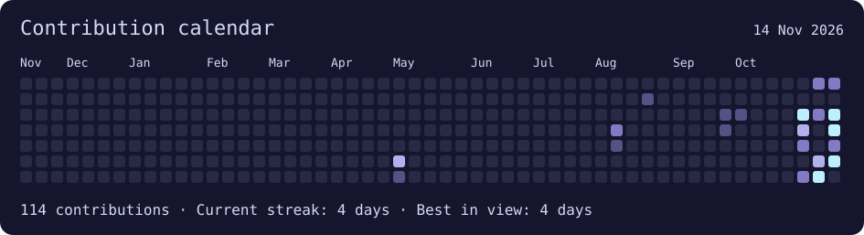

 

### `whoami`

- 🎓 I’m a final-year **Computer Science (AI & ML)** student at AITM, Bhatkal.

- 🔐 I’m exploring **cybersecurity**, especially ethical hacking. I want to understand how attackers find weaknesses in systems and how to protect the data those systems hold.

- 👁️ I’m especially interested in **computer vision**. I’ve used it to turn a raised hand into a voice command in **CampusPilot** and to estimate vehicle queues in **Adaptive Traffic Signals**.

- 🛠️ I put real effort into the details of what I build. When something doesn’t work, I like figuring out why and trying again.

 

### GitHub activity

 

### Featured build

#### 🚦 [Adaptive Traffic Signals](https://github.com/7awwad/ai-traffic-signal-optimization)

**What if a traffic light could see the queue?** Faris Ruknuddin and I built an OpenCV simulation that estimates traffic density in each approach and adjusts the green phase between **8 and 35 seconds**. The illustration shows the idea; the repository includes intersection footage and the Python controller.

[Explore the project ↗](https://github.com/7awwad/ai-traffic-signal-optimization) · [Read the signal logic](https://github.com/7awwad/ai-traffic-signal-optimization/blob/main/traffic_logic.py)

### Selected projects

#### 🎙️ [CampusPilot ↗](https://campuspilot-aitm.azurevole256.chatgpt.site)

Raise an open palm and the microphone starts listening. I connected hand detection to speech recognition so students can ask questions hands-free.

**Inside CampusPilot** · The camera and microphone do different jobs. The camera decides when to start listening. Speech recognition then has to understand the actual question. When the transcript was inaccurate, I could check the words separately from the gesture that started the session. That distinction mattered when debugging what initially looked like one recognition problem.

#### 🎮 [BlackOut ↗](https://github.com/7awwad/BLACKOUT_NOVA-AITM)

I ran Round 2 at our college event. Teams won duels, hunted for QR clues, and assembled the phone number for the winning call.

**Inside the round** · The organiser needs a different view from a player. A team needs its next clue. The organiser needs to know which teams have finished a duel, whether the hunt is open, and who made the first valid call. I had to think about what would happen in the room as well as what appeared on each screen.

#### 🔐 [CaseVault](https://github.com/ZephyrusZorro/case-vault)

- **My role** · I handled deployment for our Smart India Hackathon team.

- **Document history** · The system tracks revisions to case files.

- **Access control** · Permissions determine who can open each record.

 

#### 🚘 [Coastline · Car Rental Management](https://7awwad.github.io/DBMS/)

- **Try the demo** · Pick dates, compare full trip prices, and reserve or cancel a car. Demo bookings stay in your browser.

- **Inside the DBMS project** · An Express server stores cars, customers, and rentals in SQLite. Each rental links one customer to one car. [View source](https://github.com/7awwad/DBMS)

 

### `cat field-notes/blackout`

The last step took place outside the browser. The app could reveal all ten digits, but only the coordinator could confirm which team called first. That’s why we gave the organiser a manual finish control. [Game rules and technical notes](https://github.com/7awwad/BLACKOUT_NOVA-AITM/blob/main/docs/TECHNICAL-NOTES.md)

### On my workbench

**OmniScholar** · I work on the computer vision part of our final-year video player. We’re exploring when a lecture should pause or replay a section as the learner’s attention changes.

**Ransomware monitoring** · I’m starting a dashboard that tracks public ransomware-group claims and distinguishes them from independently confirmed incidents.

For the monitoring project, the first question I want the dashboard to answer is *what changed since the last check?* A group might repeat a claim or change a listing. I want the interface to make those changes visible while keeping the source and observation date attached to each entry.

### Tools in practice

| Area | Where I use it |
| --- | --- |
| **Python and OpenCV** | Explore camera input, inspect frames, and test which movements should trigger an action. |
| **JavaScript and Node.js** | Connect what a participant sees in the browser with the rules that decide what happens next. |
| **Express and SQLite** | Handle requests and store related car, customer, and rental records in my DBMS project. |
| **Git and GitHub Actions** | Keep project changes traceable and generate this profile’s activity map from GitHub’s contribution calendar. |

### A few things I’ve learned

**Start with an observable action.** In CampusPilot, “raise a hand and start listening” gave me something specific to test. I could check the hand, the microphone, and the transcript one step at a time.

**Keep a person in the loop where the software has no signal.** BlackOut could track scans, but the deciding event happened on a real phone. Giving the coordinator the final decision made the game rules match what we could actually observe.

**Name your part in a team project.** In CaseVault, mine was deployment. In OmniScholar, it’s computer vision. Those experiences have given me different questions to ask: how does the team run what we built, and what can the camera reliably tell us?

### Get in touch

I’m a Computer Science (AI & ML) student in Bhatkal, interested in internships in cybersecurity and applied AI. If you work on gesture interfaces, learning tools, or security monitoring, I’d enjoy hearing how you test them with real users.

[LinkedIn](https://linkedin.com/in/MohammedJawwadNagarmat) · [Email](mailto:mohammedjawwadnagarmat8@gmail.com)
