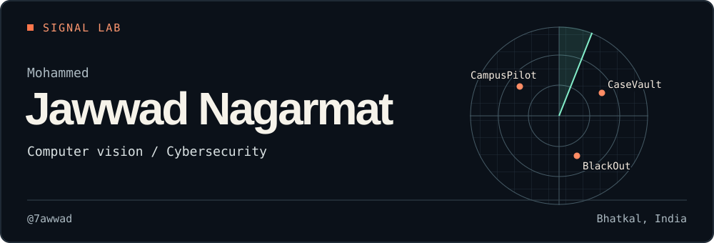

I’m **Mohammed Jawwad Nagarmat**, a Computer Science (AI & ML) student at AITM in Bhatkal. I build software that responds to what people do. A raised hand can start a conversation. A scanned QR code can change the outcome of a game.

[Explore my projects](#selected-projects) · [LinkedIn](https://linkedin.com/in/MohammedJawwadNagarmat) · [Email me](mailto:mohammedjawwadnagarmat8@gmail.com)

### Selected projects

| Project | What happens inside |
| :--- | :--- |
| **[CampusPilot ↗](https://campuspilot-aitm.azurevole256.chatgpt.site)** | Raise an open palm and the app starts listening. Hand detection triggers speech recognition so you can start talking without reaching for the keyboard. |
| **[BlackOut ↗](https://github.com/7awwad/BLACKOUT_NOVA-AITM)** | Teams duel, hunt down three QR clues, and piece together a phone number. The round ends with a real call to the coordinator. I ran Round 2 and built its game flow. |
| **[CaseVault ↗](https://github.com/ZephyrusZorro/case-vault)** | Our SIH team built a case-document system with version history and access controls. I handled deployment. |

### On my workbench

**OmniScholar** · I’m working on the computer vision side of our final-year video player. We’re exploring when a lecture should pause or replay a section as a learner’s attention changes.

**Ransomware monitoring** · I’m starting a dashboard to track public ransomware-group claims over time. One design decision is to keep a group's claim distinct from an independently confirmed incident.

### Tools I use

`Python` · `OpenCV` · `JavaScript` · `Node.js` · `SQL` · `Git`

**Interested in collaborating on computer vision or cybersecurity?** [Get in touch](mailto:mohammedjawwadnagarmat8@gmail.com).
