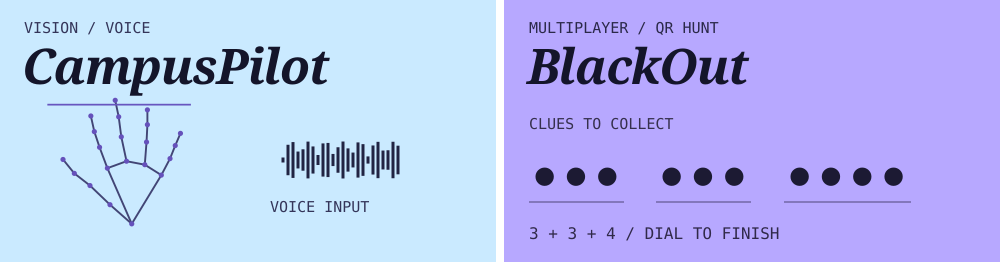
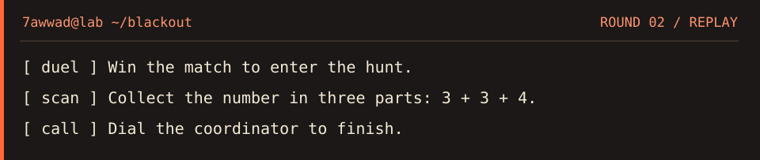

### `whoami`

I study **Computer Science (AI & ML)** at AITM in Bhatkal. I work with cameras, voice input, and security tools. Two of my projects started with a simple question: what could someone do with a raised hand or a scanned clue?

### Selected projects

`~/lab/projects`

**[Try CampusPilot ↗](https://campuspilot-aitm.azurevole256.chatgpt.site)** · Raise an open palm and the microphone starts listening. I connected hand detection to speech recognition so a student can ask a question hands-free.

**[Explore BlackOut ↗](https://github.com/7awwad/BLACKOUT_NOVA-AITM)** · I ran Round 2 at our college event. Teams won duels, scanned clues around campus, and assembled a phone number. The winning move was a real call to our coordinator.

**[View CaseVault ↗](https://github.com/ZephyrusZorro/case-vault)** · I handled deployment for our SIH team's case-document system, which tracks file versions and controls who can access each record.

### `cat field-notes/blackout`

The last step took place outside the browser. The app could reveal all ten digits, but only the coordinator could confirm which team called first. That’s why we gave the organiser a manual finish control. [Game rules and technical notes](https://github.com/7awwad/BLACKOUT_NOVA-AITM/blob/main/docs/TECHNICAL-NOTES.md)

### `cat experience/security`

During my internship at **Syberweb Technologies**, I helped with endpoint protection, mobile device management, and email signature deployment. My work included user acceptance testing, troubleshooting, and documenting setup steps for support. That experience got me interested in how a security team checks that a tool actually works on the devices it manages.

### On my workbench

**OmniScholar** · I work on the computer vision part of our final-year video player. We’re exploring when a lecture should pause or replay a section as the learner’s attention changes.

**Ransomware monitoring** · I’m starting a dashboard that tracks public ransomware-group claims and distinguishes them from independently confirmed incidents.

### `ls toolbox/`

| Area | How I use it |
| --- | --- |
| Python · OpenCV | Process camera frames and test what a gesture or movement should trigger. |
| JavaScript · Node.js | Build browser interactions and connect them to application logic. |
| SQL · SQLite | Model cars, customers, and rentals in my [car rental project](https://github.com/7awwad/DBMS). |
| Git | Track changes and coordinate deployment work with teammates. |

### `contact`

I’m interested in internship opportunities in cybersecurity and applied AI.

[LinkedIn](https://linkedin.com/in/MohammedJawwadNagarmat) · [Email me](mailto:mohammedjawwadnagarmat8@gmail.com)

